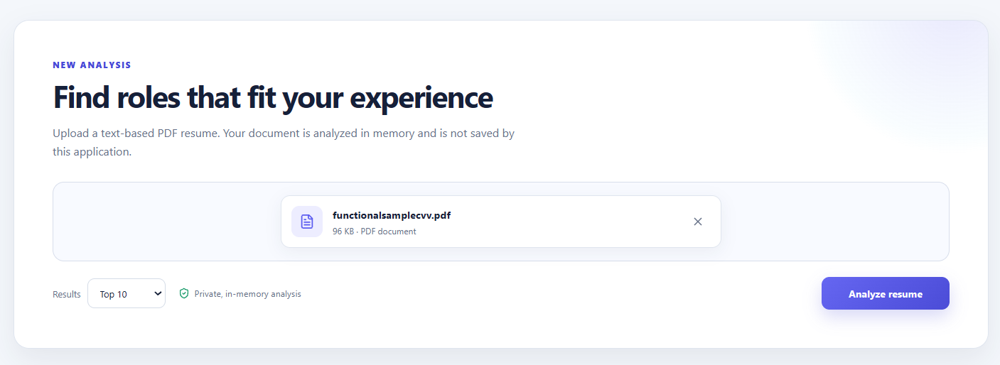
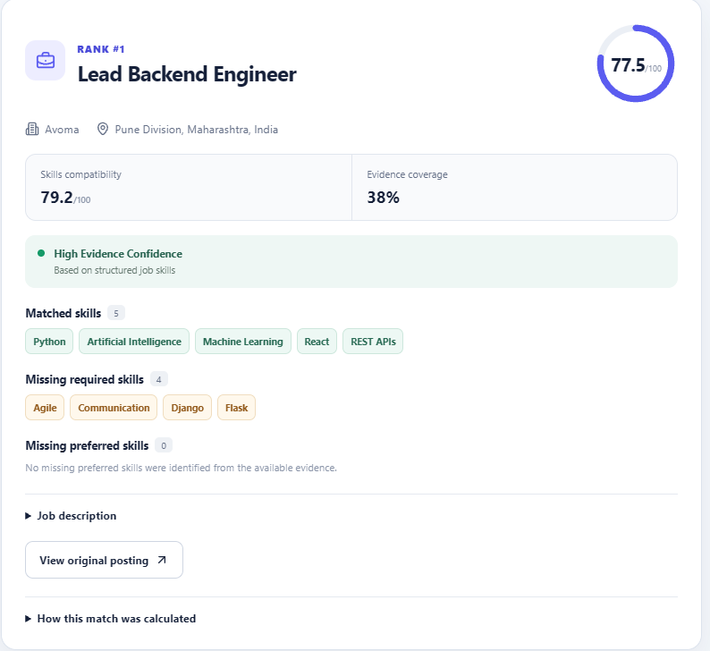
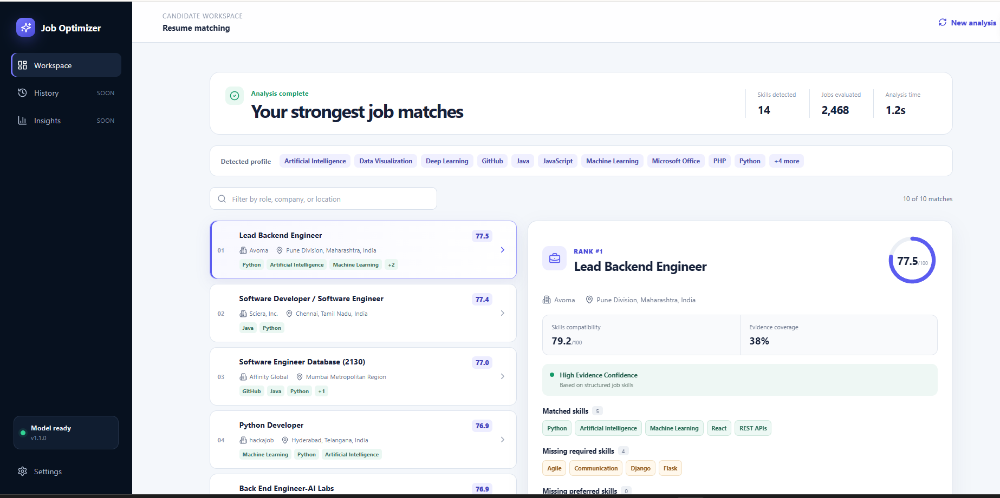

## Project Overview

Job Optimizer is an AI-based system designed to help job seekers identify suitable job opportunities based on their skills and resume content.

The system accepts a resume in PDF format, extracts relevant information, identifies technical skills, and compares the candidate's profile with available job descriptions.

It combines semantic similarity using Sentence-BERT and graph-based learning using a Heterogeneous Graph Neural Network to generate ranked job recommendations.

The main objective is to make job recommendations more meaningful than simple keyword-based matching.

## Key Features

- **Resume Analysis:** Upload and analyze resumes in PDF format.
- **Skill Extraction:** Automatically identify technical skills from resume content.
- **Semantic Matching:** Understand the meaning and context of resume content and job descriptions using Sentence-BERT.
- **Graph-Based Learning:** Use a Heterogeneous Graph Neural Network to capture relationships between candidates, skills, and job roles.
- **Hybrid Ranking:** Combine semantic similarity and graph-based predictions to rank suitable jobs.
- **Job Recommendations:** Display the most relevant job opportunities based on candidate profiles.
- **Skill Gap Analysis:** Identify matched and missing skills to help candidates understand their job compatibility.
- **Compatibility Score:** Generate a score to represent the estimated compatibility between a candidate profile and a job.
- **REST API:** Provide backend functionality through FastAPI endpoints.
- **Interactive Dashboard:** Present resume analysis and job recommendations through a React-based frontend.

## System Architecture

The project follows a separate frontend and backend architecture.

<p align="center">    </p>

### Architecture Explanation

1. **Frontend:** The candidate uploads a resume through the React application.
2. **Backend:** FastAPI receives the PDF file and processes the request.
3. **Text Extraction:** Resume text is extracted using PDF parsing.
4. **Skill Extraction:** Relevant skills are identified and normalised.
5. **Semantic Processing:** Sentence-BERT converts text into semantic embeddings.
6. **Graph Processing:** Candidate skills and job relationships are represented using a heterogeneous graph.
7. **GNN Inference:** The trained GNN model generates graph-based predictions.
8. **Hybrid Ranking:** Semantic and graph-based scores are combined.
9. **Results:** The system returns ranked job recommendations, compatibility scores, and skill gap information.

## Technology Stack

| Category | Technologies |
|---|---|
| Programming Language | Python |
| Frontend | React.js, TypeScript, Vite |
| Backend | FastAPI |
| Machine Learning | PyTorch |
| Natural Language Processing | Sentence-BERT (SBERT) |
| Deep Learning | Heterogeneous Graph Neural Networks |
| Text Processing | NLP, Text Cleaning, Skill Extraction |
| PDF Processing | PyPDF |
| API Communication | REST API |
| Containerisation | Docker |
| Development Tools | VS Code, Git, GitHub |

## AI and Machine Learning Approach

### 1. Sentence-BERT (SBERT)

Sentence-BERT is used to generate semantic embeddings from resume content and job descriptions.

It helps the system understand the contextual similarity between candidate profiles and job requirements instead of depending only on exact keyword matches.

**Main purpose:**
- Convert text into numerical embeddings.
- Capture semantic relationships.
- Calculate similarity between resumes and job descriptions.

### 2. Heterogeneous Graph Neural Network (GNN)

The project uses a Heterogeneous Graph Neural Network to model relationships between different types of entities.

The graph represents relationships between:
- Candidates
- Technical skills
- Job roles

The GNN uses graph structure and learned representations to generate graph-based compatibility predictions.

**Main purpose:**
- Capture relationships between skills and job roles.
- Learn from graph-based information.
- Generate predictions using graph representations.

### 3. Hybrid Ranking Approach

The system combines semantic similarity and GNN predictions to generate final job rankings.

The current validated model configuration uses:

| Model Component | Weight |
|---|---:|
| Heterogeneous GNN | 78% |
| Sentence-BERT | 22% |

The hybrid approach combines contextual text similarity with graph-based relationship learning.

**Note:** These weights represent the current selected ranking configuration, not a universal rule for all recommendation systems.

## Project Model Information

| Parameter | Value |
|---|---|
| Model Name | Job Optimizer Semantic Graph Matcher |
| Model Version | 1.1.0 |
| Ranking Policy | validation_selected_gnn_sbert_hybrid |
| GNN Weight | 0.78 |
| SBERT Weight | 0.22 |
| Rankable Job Records | 2,468 |
| Inference Mode | Pre-trained model inference |
| Database | No database required |

The system loads its saved model assets, graph information, job records, skill catalogue, and ranking configuration during backend startup.

It does not retrain the models or download the job dataset during normal application startup.

## Project Structure

```text
Job-Optimizer/
│
├── api/
│   ├── main.py
│   └── errors.py
│
├── frontend/
│   ├── src/
│   ├── public/
│   ├── package.json
│   └── vite.config.ts
│
├── src/
│   └── job_optimizer_engine.py
│
├── models/
│   ├── sbert/
│   │   └── model/
│   ├── gnn/
│   │   └── heterogeneous_gnn.pt
│   └── final/
│       ├── model_config.json
│       └── ranking_policy.json
│
├── data/
│   └── processed/
│       ├── graph/
│       ├── jobs_features_enriched.json
│       ├── skill_catalog.json
│       └── skill_aliases.json
│
├── scripts/
│   ├── build_sbert_embeddings.py
│   ├── extract_job_skills.py
│   └── train_heterogeneous_gnn.py
│
├── Dockerfile
├── .dockerignore
├── requirements-cloud.txt
└── README.md
```

*Note: This is a simplified view of the important project files and directories.*

The resume analysis endpoint accepts a PDF file through a multipart form upload.

## Example Workflow

1. Open the Job Optimizer application.
2. Upload a candidate resume in PDF format.
3. The backend extracts the resume text.
4. The system identifies and normalises technical skills.
5. SBERT generates semantic representations.
6. The GNN performs graph-based inference.
7. The hybrid ranking engine calculates job compatibility.
8. The system displays ranked job recommendations and skill gap information.

## Model Evaluation and Testing

The project includes a pre-trained GNN model and a saved SBERT model for inference.

The backend has been tested locally using Docker.

The following checks have been performed:

- Backend health and readiness checks.
- Model loading and configuration validation.
- Resume PDF text extraction.
- Technical skill extraction.
- Graph skill matching.
- Job recommendation generation.
- Hybrid ranking output validation.

The current backend reports 2,468 rankable job records.

## Screenshots
## Application Screenshots

### Home Page

<p align="center">    </p>

### Resume Analysis

<p align="center">    </p>

### Job Recommendations

<p align="center">    </p>


## Project Limitations

- Recommendation quality depends on the quality and completeness of resume and job information.
- Some job records may not contain complete structured skill information.
- Compatibility scores represent estimated profile-to-job compatibility, not the probability of getting hired.
- Closely grouped scores may indicate similar compatibility between multiple job opportunities.
- Recommendations are intended to support job seekers and do not replace recruiter or employer decisions.
- The current system uses a fixed, pre-trained model configuration for inference.

## Future Improvements

- Improve skill extraction and normalisation.
- Expand and update the job dataset.
- Improve graph construction and GNN performance.
- Evaluate ranking quality using metrics such as Precision@K, Recall@K, and NDCG.
- Add user feedback to improve recommendation quality.
- Improve model explainability and skill gap analysis.
- Deploy the frontend and backend for easier public access.

## Why This Project?

Traditional job matching systems often depend heavily on keyword matching.

Job Optimizer explores a combination of semantic understanding and graph-based learning to improve how candidate profiles are matched with job opportunities.

This project demonstrates the practical application of NLP, deep learning, graph neural networks, REST API development, and modern frontend technologies in a real-world recruitment use case.

## Author

**Rocky Kundu**

### Connect With Me

- **GitHub:** https://github.com/rockykundu

---

*Developed as an academic and portfolio project to explore AI-powered resume analysis and intelligent job recommendation systems.*
